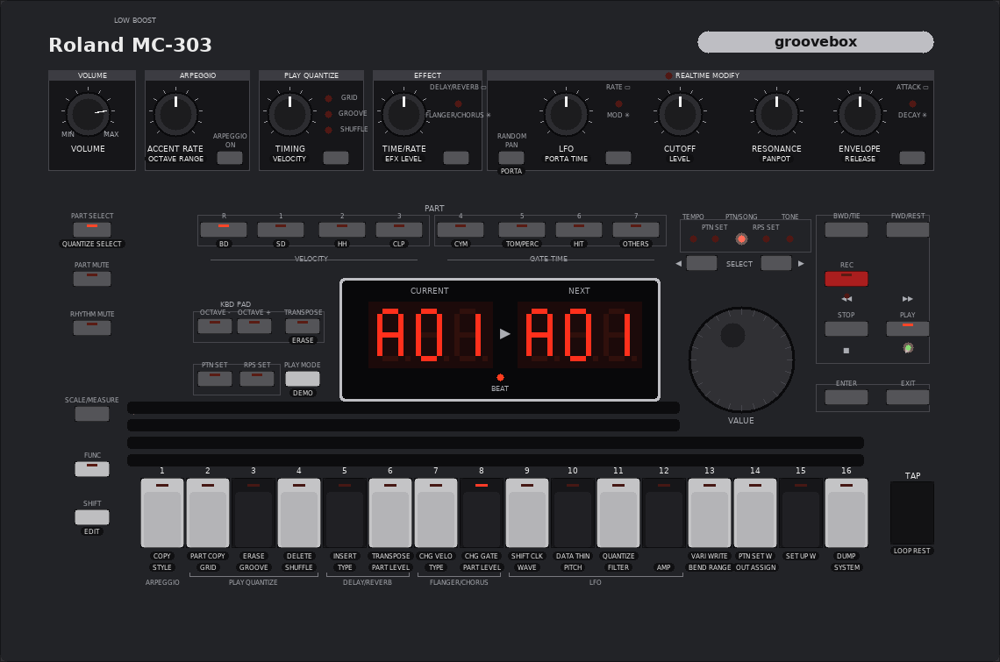

# Roland MC-303 emulation

Reverse engineering of the Roland MC-303 groovebox (1996) and a simulator that runs its original
firmware on Linux: the unmodified OS ROM executes on an emulated Fujitsu MB90705, the Roland PCM chip
is [Nuked-SC55](https://github.com/nukeykt/Nuked-SC55)'s decap-derived model, and the panel, LED
displays, timers, ADC, MIDI UART and battery-backed RAM are modelled from the service-manual schematic
and from what the firmware itself does with the I/O registers. Same approach as the
[MMT-8 simulator](https://github.com/audiodestrukt/mmt8).



**Status (2026-10-14):** boots to the pattern-mode screen (lamp test, "MC-303" splash with spinner,
then `A01 A01`), and the front panel is now the real one: every button, pad, knob and the VALUE dial
is wired to the firmware through the switch matrix, the ADC and the encoder inputs, and all LEDs,
the BEAT lamp and the two displays are read back from the scan the firmware performs. PLAY runs the
preset patterns through the PCM chip model (step light on the pads, PLAY LED, beat lamp), the pads
play the selected part, the VALUE dial changes patterns, FUNC+pad functions work, the factory preset
runs, and MIDI goes in and out (clock, active sensing, the boot reset burst). Real sound needs a dump
of the 4 MB wave ROM (IC3), which is not done yet; with any TC6116AF-family wave ROM as a stand-in,
notes come out as pitched, enveloped samples (the wrong ones).

```
cd sim && make
./mc303sim --gui          # front panel with audio; ROMs and user memory are found next to the binary
./mc303sim -t 3           # headless boot, prints the displays
```

ROM images are not included. Put the OS and data EPROM dumps in `roms/` (see below) and the wave ROM
as `roms/waverom.bin` when you have it.

## Hardware (from the May 1996 service notes, `docs/`)

| Ref | Part | Role |
|-----|------|------|
| IC1 | Fujitsu **MB90705** (F2MC-16), 24.000 MHz crystal | CPU. 24-bit address bus A0-A23, 16-bit data bus D0-D15. No internal ROM. |
| IC7 | HN27C4000 / HN27C4096 4 Mbit EPROM (512 KB) | Program ("OS") ROM |
| IC8 | uPD23C4000 4 Mbit mask ROM (or EPROM) | Phrase / preset pattern data ROM |
| IC5, IC6 | 2 x KM681000 128 KB SRAM | Working RAM, CR2032 backed |
| IC2 | **TC6116AF** | Roland PCM chip + gate array (same part as SC-55mk2, JV-880, SCB-55) |
| IC3 | uPD23C32000 32 Mbit mask ROM (4 MB) | Wave ROM, on the PCM chip's private bus (WA0-20 / WD0-15) |
| IC4 | HM65256 32 KB SRAM | Effect (reverb/delay) memory, on the PCM chip's private bus (EA0-14 / ED0-7) |
| IC9 | uPD63200 | DAC, serial from the PCM chip |
| IC11 | 74HC4051 | Analog mux: 8 panel knobs -> CPU AN0 (mux select AMUX0-2 on P80-P82) |
| IC13/14 | 74HC175 + 74HC20 | Rotary encoder -> EINC / EDEC pulses on PA1/DREQ1 and PA2/DREQ2 (vectors 21 / 23) |
| IC12 | TC3W01F | A19 decoder: CPU CS0 -> XCSL (IC8) / XCSH (IC7) |

Panel board: 4 scan lines SC0-SC3 (CPU PC0-PC3) drive two 74HC138 decoders, one selecting a
switch column, one selecting an LED sink (TD62384). SD0-SD7 (CPU PB0-PB7) is a bidirectional
8-bit bus through a 74HC245 (DIR: high = drive LED source driver TD62785, low = read switches).
Display is two 3-digit LB-603VP LED displays plus ~60 discrete LEDs; there is no LCD.
MIDI uses UART1 (SIN1/SOUT1, TX interrupt vector 40 drains the firmware's output ring); TAP is P97,
PEDAL P56, the two-colour BEAT LED hangs off P54/P55, and the seven ADC knobs plus the backup
battery go through the 74HC4051 (see `sim/README.md` for the complete switch, LED and knob maps).

### CPU memory map (from schematic + firmware)

| Address | Device |
|---------|--------|
| `000000-0000FF` | F2MC-16 internal I/O registers |
| `A00000-A3FFFF` | Working SRAM (IC5/IC6), selected by CS5. Stack top `A0FFFA`, DTB/ADB/SSB/USB = `A0`/`A1` |
| `F00000-F7FFFF` | Data ROM IC8 (CS0, A19 = 0) |
| `F80000-FFFFFF` | OS ROM IC7 (CS0, A19 = 1). Vector table at `FFFF00-FFFFFF`, reset vector `FF05C9`, mode byte `0x80` |
| `00E000-00E07F` | TC6116AF (PCM + gate array) registers via GPCS, accessed as `ADB:0xE0xx` with ADB = 0. Even addresses only, i.e. 64 16-bit registers - the same 0x00-0x3F register file Nuked-SC55's `pcm.cpp` models. `E07C` is read in the GPINT handler |

Note the TC6116AF's gate array half also generates system chip selects (its CS5 output drives the SRAM)
and raises GPINT to the CPU, just as in the SC-55mk2 (Nuked-SC55's `MCU_GA_*`).

## ROMs (`roms/`, not committed)

| File | Chip | Contents |
|------|------|----------|
| `1.03 [27C4096][37OD][Program OS][IC 7].BIN` | IC7 | OS v1.03, 512 KB, byte order as seen by the CPU (little-endian) |
| `1.0 [27C4096][C673][DATA OS][IC 8].BIN` | IC8 | Preset data, 512 KB. Header `RolandMC-303N` + `00-100-09`, then a tagged directory: `PTBD`, `RPBD`, `PTIF`, `RPSU`, `nPTN`, `nRPS` |

Wave ROM (IC3) is not dumped yet. It is a 42-pin 2M x 16 mask ROM that reads as a 27C322.

## Firmware notes (OS 1.03)

- Reset code at `FF05C9`: sets up I/O regs `0xA0-0xA5`, `0x28-0x2F` (external bus / chip-select config),
  clears RAM in banks `A0`/`A1` with `FILSI`, copies `.data` initialisers from ROM banks `FA`/`F8`, sets SP,
  then calls `main` = `sub_FF07F4` (returning from it jumps back to reset).
- `main` builds a table of 16-byte task control blocks at `A0:4054` with entry points loaded via
  `MOVL A, #imm32` (e.g. `FAB045`, `FAB2F6`, `FB6CFC`, ...). Heavy use of `INT9` = RTOS system call.
- **Kernel.** A small event-flag scheduler, entered through software interrupts with C-style stack
  arguments (`PUSHW` args, `INT #n`, `ADDSP`). It does *not* use `INT9`; the ~290 `INT9` opcodes in the
  linear listing are `0x01` bytes inside data tables. Decoded from the handlers:

  | Call | Handler | Semantics |
  |------|---------|-----------|
  | `INT #3` (blk, ptn) | `FF044B` | set flag bits from an ISR: `blk->flags \|= ptn`, no reschedule |
  | `INT #6` (blk, ptn) | `FF03BB` | set flag bits from a task; reschedules if a higher-priority task waits on them |
  | `INT #7` (res*, blk, mask) | `FF0460` | wait for flags: `blk->wait = mask`; if satisfied return `*res = flags & mask` and clear, else sleep |
  | `INT #5` (blk) | `FF04D5` | wait using the block's saved mask (`+4`); sleeps and schedules if not satisfied |
  | `INT #4` (blk) | `FF0521` | save `wait` into `+4` and clear it (cancel wait) |
  | `JMP 0x041A` | `FF041A` | ISR exit: if not nested, mark current task waiting, save SP, run scheduler `FF0499` |

  Flag block: `+0` pending flags, `+2` wait mask, `+4` saved mask, `+6` -> task context (`+0` state,
  `+1` priority, `+6` saved SP). Current task pointer at `A0:0002`. Scheduler scans 11 blocks of 8 bytes
  from `A0:4124` in priority order; `main` initialises the 16-byte task contexts at `A0:4054` with the
  entry points `F8CCC3 F8CE5E F8CE9F FA7580 FAB045 FAB2F6 FAFF00 FB6CFC FB6EF2 FF0CAC FFEFB5`.
  Whether this is a stripped REALOS/907 configuration or Roland's own kernel is open; the REALOS
  User's Guide (`reference/realos.pdf`, CM42-00325) only confirms the ISR/C conventions.
- **Preset data in the OS ROM.** Patch records of 108 bytes, 12-char name first: 448 at `FC0000` and
  448 at `FD0000` (e.g. `DistTB 1`, `DistortionGt`); rhythm instrument records at `FCBD00`/`FDBD00`
  (`TBSqDst2`, `GUN_SHOT`). `FE0000+` is mostly unused (`FF`), `FECA78+` holds more tables.
- Panel scan ISR `sub_FF00C1` (vector #27, timer driven): 16 scan steps kept in `A0:5D7A`.
  Per step: P8 low bits = AMUX select (knob mux), ADC data `I:0x6A` -> `A0:5D6E+n`, ADC start via `I:0x69`;
  DDR B = 0, DIR (PC0) low, read switches `I:0x0B` (inverted) -> `A0:5CFA+col`; TAP/PEDAL from `I:0x05` bit 6
  and `I:0x09` bit 7 -> `A0:5D03`; LED column data from `A0:5D1A+col` (blink mask `A0:5D3A+col`) -> `I:0x0B`,
  DDR B = 0xFF, `I:0x0C` = col << 1 (SC0-3 on PC1-4), PC0 high.
- Other vectors: `FF0193/FF0148` (`I:0x30`/`0x35` flags), `FF01A5/FF01B8` -> `FFEB53` (UART1 = MIDI rx/tx,
  flags `I:0x31`/`0x32`), `FF01CB` = GPINT from the PCM chip (reads `00:E07C`, calls `F8C85A`),
  `FF01E7/FF01FA/FF0216` -> `FAAB09/FAAE74/FAAEEB` (timers, flags `I:0x39/0x3E/0x79/0x7E`).
- Peripheral init helpers `FF025C-FF02B6`: UART1 at `I:0x24-0x27` (+`0x4F`, `0xBE`), reload timers at
  `I:0x40-0x67`, PPG at `I:0x3A-0x3E`. The register layout resembles MAME's F2MC-16L MB90610A map but is
  not identical (no MB90705 datasheet found yet; alldatasheet has none despite the search hit).
- Recursive descent from the vectors plus function-pointer immediates reaches ~16 % of the ROM (~700
  functions) cleanly; the rest is data (patches, .data images, tables) or code behind `JMP @A` jump tables.

## Simulator (`sim/`)

`sim/mc303sim` boots the real firmware: MAME's F2MC-16 core (with a shim instead of the MAME
framework, plus a dozen missing instructions and two bug fixes), Nuked-SC55's PCM chip model, and a
board model written from the schematic and the firmware's own I/O usage. It reaches the normal
pattern-mode screen (`A01`) after the lamp test and the "MC-303" splash, scans the panel, sends MIDI
active sensing, and responds to keys. The GUI reproduces the front panel from the service-notes
layout drawing; the switch, LED and knob matrices were mapped from the panel schematic and verified
by pressing every matrix position and watching what the firmware did. See `sim/README.md`.

## Tools

`tools/f2mc16dasm/` - MAME's F2MC-16 disassembler (BSD-3, by AJR) built standalone with a small `emu.h` shim.

```
cd tools/f2mc16dasm && make
./f2mc16dasm    ROM F80000 [start] [end]   # linear listing
./f2mc16dasm -r ROM F80000 [extra seeds]   # recursive descent from the vector table
```

`disasm/os_1.03_code.lst` is the recursive-descent listing, `disasm/os_1.03_linear.lst` the raw linear one.

## Plan

1. Sound engine: reuse Nuked-SC55's `pcm.cpp` (GPL-2+, decap-derived TC6116AF emulation).
2. CPU: MAME's `cpu/f2mc16` core (BSD-3), plus an MB90705 peripheral variant (UART, timers, ADC, ports).
   Still-unimplemented opcodes in MAME's core: CMR, NCC, SUBDC, DIVU/MULU A, CALLV, ADD/SUB A dir.
3. Board glue from the schematic, SDL front panel (done) + ALSA MIDI as in the MMT-8 simulator.

## Credits

This project stands on other people's reverse engineering, and the sound engine is not ours at all:

- **[Nuked-SC55](https://github.com/nukeykt/Nuked-SC55)** by **nukeykt** — the TC6116AF PCM chip
  emulation (`sim/pcm.cpp`, used unmodified) that produces every sample this simulator makes. Its
  register interface, sample decoding, envelope, address generator and effects were all recovered from
  the silicon, and it is why the MC-303's firmware talks to a "real" chip here. GPL-2.0-or-later.
- **John McMaster** ([siliconprawn.org](https://siliconprawn.org)) — decapped and imaged the PCM chip
  that Nuked-SC55's model was derived from.
- **MAME** — the Fujitsu F2MC-16 CPU core by **R. Belmont** and the disassembler by **AJR**
  (`sim/f2mc16.cpp`, `sim/f2mc16d.cpp`, BSD-3-Clause), extended here with the instruction forms the
  MC-303 firmware needs and two interrupt/return-address fixes.
- **Roland** — the 1996 MC-303 service notes, whose block diagram and schematics made the board model
  possible.

## Open items

- MB90705 datasheet / MB90700-series hardware manual (I/O register map, chip-select registers). Not on
  alldatasheet (the 41-page hit is an unrelated MB90050). The Roland A-90 also uses this CPU.
  `reference/MB90570A_datasheet.pdf` is the F2MC-16LX MB90570A, a different chip; see `reference/NOTES.md`
  for what does and does not carry over.
- REALOS/907 *Kernel* manual (the User's Guide is in `reference/`) would settle whether the kernel is REALOS.
- Follow jump tables (`JMP @A`) to raise disassembly coverage.
- Dump the wave ROM (needed for any sound; the simulator boots without it).
- ALSA MIDI ports for the GUI.
- The knob-to-ADC-channel map is derived from the schematics and board drawing; confirming it with the
  service ADC test needs the pedal test (test 3) to pass first, which it does not in the simulator yet.
- SHIFT+pad (EDIT) functions show nothing on the display so far; FUNC+pad functions do.
