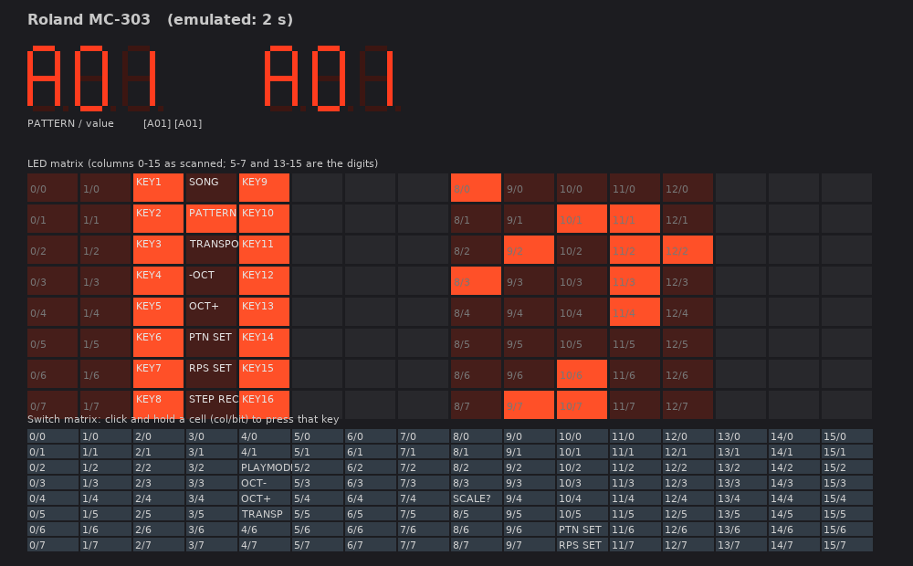

# MC-303 simulator

Runs the original MC-303 OS ROM on an emulated MB90705 with the PCM chip modelled by Nuked-SC55's
`pcm.cpp`. The GUI is a front panel laid out like the real unit; every control goes through the
firmware (switch matrix, ADC, encoder pulses), and the LEDs and displays are read back from what the
firmware scans out.

```
make
./mc303sim --gui                # front panel with audio
./mc303sim -t 3                 # headless: boot for 3 emulated seconds, print the display changes
```

ROM images are looked up relative to the executable: `../roms/` for the OS and data EPROMs, the wave
ROM as `../roms/waverom.bin` (raw) or, failing that, `../roms/standin_sc55mk2_4mb.bin` (an SC-55mk2
image, auto-unscrambled, wrong sounds). Battery-backed user memory lives in `../roms/mc303.sram` and
is written back when the GUI quits. On the very first GUI run there is no such file: the simulator
then performs the factory preset itself (hold FUNC at power-on, ENTER at the `SUrE` prompt), because
blank user memory boots fine but leaves the keyboard-pad velocity at 0, so the pads are silent.



## GUI

Mouse: click and hold buttons and pads, drag (or wheel over) the knobs, drag or wheel the VALUE dial.
Keyboard: `Space` PLAY, `Backspace` STOP, `Enter` ENTER, `Shift` SHIFT, `Ctrl` FUNC, `Alt`
SCALE/MEASURE, `Tab` TAP, arrow keys turn the VALUE dial, `F1`-`F8` are the part buttons R, 1-7,
`Z X S C D V B G N H M J , . L /` are pads 1-16 (piano style: pad 1 is B, the sharps are on the upper
row), `Q 2 W 3 E R 5 T 6 Y 7 U I 9 O 0 P` send MIDI notes in on channel 1. `Esc` quits and saves
user memory.

Headless options:

| Option | Meaning |
|--------|---------|
| `-t SECONDS` | emulated run time |
| `--press COL BIT [T_ON T_OFF]` | hold a switch-matrix position (table below), optionally only between two times |
| `--tap T_ON T_OFF`, `--pedal T_ON T_OFF` | the TAP key (P97) and the pedal switch (P56) |
| `--enc +1\|-1 T` | one detent of the VALUE dial at time T |
| `--knob CH VALUE [T]` | ADC channel CH (0-7) to VALUE (0-255), at boot or at time T. Channel 4 is the battery monitor and must stay in 0x80-0xC0 (`Err 1` otherwise); the others default to mid-travel |
| `--factory` | script the factory preset (FUNC held at power-on, ENTER at 2.5 s); done ~1 s later |
| `--sram FILE`, `--nosram` | user memory file (default `../roms/mc303.sram`), or blank memory that is not saved |
| `--midi T "90 3C 7F"` | inject MIDI bytes into the UART at time T |
| `--wav FILE` | record the PCM chip output (stereo 16-bit, 33103 Hz) |
| `--midiout FILE` | write every byte sent on MIDI OUT to FILE at exit |
| `--os FILE`, `--data FILE` | alternative OS / data ROM images (e.g. the wave-dump OS from `tools/wavedump/`) |
| `--waverom FILE [--unscramble]` | wave ROM image; larger files are truncated to 4 MB, `--unscramble` applies Nuked's pin-order permutation |
| `--ledlog` | print the LED scan buffer and the BEAT LED whenever they change |
| `--trace CYCLE [--task BLOCK]` | instruction trace from a cycle count, optionally only while a given task (flag block address) is current |
| `--bp ADDR [--bpdump ADDR N]` | print A/PS/SP/stack (and N bytes of memory) when PC hits ADDR |
| `--wp ADDR` | print writes to an address (bank A0 = SRAM, A1 = SRAM upper half) |
| `--poke ADDR VAL T` | write a byte at time T |
| `--dumpw ADDR N` | dump N words at exit |
| `--irq`, `--io`, `--ga` | trace interrupts, I/O register writes, PCM chip accesses |
| `--check` | verify every executed instruction's length against the disassembler (catches core bugs) |
| `--shot FILE T` | start the GUI and save a screenshot at emulated time T (works with `SDL_VIDEODRIVER=dummy`) |

Useful recipes:

```
./mc303sim -t 6 --press 2 4 2.0 2.2 --wav play.wav        # press PLAY: pattern A01 through the PCM chip
./mc303sim -t 3 --press 11 3 2.0 2.6 --press 0 7 2.2 2.4  # FUNC + pad 16 = SYSTEM: display shows "tUn 40.0"
./mc303sim -t 3 --enc 1 2.0                               # VALUE dial: A01 -> A02
./mc303sim -t 4 --press 8 4 0 1.5 --press 12 0 0 1.5      # service test mode (ARPEGGIO ON + R(BD) at power-on)
```

## Audio

The PCM chip is clocked at 24 MHz (the CPU crystal) and, with the firmware's 28-slot configuration,
produces one frame every 725 cycles = 33103 Hz, the same rate Nuked uses for the SC-55mk2. The wave
ROM (IC3, uPD23C32000GX-364, 4 MB, SOP-44 on the PCM chip's private bus) has not been dumped yet, so
there is no real sound; with any 4 MB image as a stand-in, pads, MIDI notes and PLAY produce
enveloped output, which proves the path. The IC8 "DATA" EPROM is preset pattern data, not samples.

## Board model (mc303.cpp)

- Memory: OS ROM F80000, data ROM F00000, 256 KB SRAM A00000-A3FFFF, internal RAM 0100-1FFF, I/O 00-FF.
- PCM/gate array: bank 0 `E000-E0FF`, register = address >> 1, forwarded to `PCM_Read/PCM_Write`.
  The PCM chip's IRQ is GPINT on PA3/DREQ3 (flag `I:0x33` bit 2, vector 25).
- Interrupt controller: ICR00-15 at `B0-BF`, vector v uses ICR (v-11)/2; highest priority (lowest
  level) pending vector wins; accepted when level < ILM.
- Reload timers (control at 0x40/0x48/0x50/0x58/0x60, reload at +4): CNTE bit1, UF bit2, INTE bit3,
  RELD bit4, prescaler bits 10-11 (2/8/32). Vectors 11, -, 14, 15, 16.
- Period timers at 0x38/0x78: 16-bit period at +4 -> flag +6 bit3 (vectors 29, 31), 8-bit period at
  +2 -> flag +6 bit2 (vector 30). Both behind a /128 prescaler (guess; gives 267 ms active sensing).
- ADC at 0x68-0x6B: start = 0x69 bit5, done flag bit7 (cleared by writing 0), INTE bit3, vector 27,
  1000 cycles per conversion, 8-bit result in 0x6A. The panel scan ISR restarts it every step, so the
  panel refresh rate follows CPU load, as on the real unit.
- UART1 at 0x24-0x27 = MIDI (SMR 0x24, SCR 0x25, data 0x26, SSR 0x27: RDRF bit4, TDRE bit3, RIE bit1,
  TIE bit0). RX = vector 39. TX = vector 40 (handler FF0009, shares ICR14 with RX): the firmware keeps a
  MIDI-out ring buffer and sets TIE while it has data, so TDRE drops for one byte time (3840 cycles)
  after each write and the transmit interrupt drains the ring. Without this interrupt the ring fills
  and anything that queues MIDI output spins forever; the factory preset was the first victim.
- Encoder: EINC/EDEC pulses from the 74HC175/74HC20 pair reach PA1/DREQ1 and PA2/DREQ2; the firmware
  services them as vectors 21 and 23 (flags `I:0x31`/`I:0x32` bit 2) and adds -1/+1. `encoder(dir)`
  raises the right flag.
- Ports: B = SD0-7 (switch read when DDR B = 0 and PC0 low, LED data otherwise), C bit0 = DIR,
  bits1-4 = scan column, P8 bits0-2 = analogue mux select, P97 = TAP (inverted), P56 = pedal
  (inverted), P54/P55 = BEAT LED red/green (active low; red on every beat, green on the bar).

## Panel decode

Displays: left (CURRENT) = columns 7,6,5, right (NEXT) = columns 13,14,15 (one column per digit;
bit0..6 = A..G, bit7 = DP, lit when 0). Columns 2 and 4 carry no LEDs. Discrete LEDs, lit when 0:

| Column | bit 0 | 1 | 2 | 3 | 4 | 5 | 6 | 7 |
|--------|-------|---|---|---|---|---|---|---|
| 0 | pad 9 | pad 10 | pad 11 | pad 12 | pad 13 | pad 14 | pad 15 | pad 16 |
| 1 | pad 1 | pad 2 | pad 3 | pad 4 | pad 5 | pad 6 | pad 7 | pad 8 |
| 3 | SONG | PATTERN | TRANSPOSE | OCTAVE - | OCTAVE + | PTN SET | RPS SET | STEP REC |
| 8 | PART SELECT | RHYTHM MUTE | PART MUTE | - | ARPEGGIO | GRID | GROOVE | SHUFFLE |
| 9 | TEMPO | PTN SET | PTN/SONG | RPS SET | TONE | PLAY | REC | - |
| 10 | REALTIME MODIFY | - | EFFECT | PORTAMENTO | LFO | ENVELOPE | - | - |
| 11 | FUNC | - | - | - | SCALE 1 | SCALE 2 | SCALE 3 | SCALE 4 |
| 12 | part R | 1 | 2 | 3 | 4 | 5 | 6 | 7 |

The pad LEDs are the running step light while the sequencer plays. The EFFECT, LFO and ENVELOPE LEDs
each show two functions, lit versus blinking (DELAY/REVERB vs FLANGER/CHORUS, RATE vs MOD, ATTACK vs
DECAY); the blink mask at A0:5D3A is applied by the scan ISR, so the simulator's LED state already
includes it.

Switches (`--press COL BIT`), from the panel schematic and verified by what the firmware does:

| Column | bit 0 | 1 | 2 | 3 | 4 | 5 | 6 | 7 |
|--------|-------|---|---|---|---|---|---|---|
| 0 | pad 9 | pad 10 | pad 11 | pad 12 | pad 13 | pad 14 | pad 15 | pad 16 |
| 1 | pad 1 | pad 2 | pad 3 | pad 4 | pad 5 | pad 6 | pad 7 | pad 8 |
| 2 | BWD/TIE | FWD/REST | REC | STOP | PLAY | ENTER | EXIT | - |
| 4 | PTN SET | RPS SET | PLAY MODE | OCTAVE - | OCTAVE + | TRANSPOSE | - | - |
| 8 | PART SELECT | RHYTHM MUTE | PART MUTE | PLAY QUANTIZE | ARPEGGIO ON | - | - | - |
| 10 | - | - | EFFECT | RANDOM PAN/PORTA | LFO | ENVELOPE | SELECT < | SELECT > |
| 11 | - | SCALE/MEASURE | SHIFT | FUNC | - | - | - | - |
| 12 | part R | 1 | 2 | 3 | 4 | 5 | 6 | 7 |

Column 9 is overwritten by the firmware with TAP (bit 7, from P97) and the pedal (bit 6, from P56).
The schematic draws FUNC on bit 2 and SHIFT on bit 3, but the firmware answers to bit 3 with the
FUNC functions (STYLE, TYPE, SYSTEM...), so the GUI labels them that way. Pad 1 is B3; pads 3, 5, 8,
10, 12 and 15 are the black keys. Switch events are encoded by the firmware as `col*16 + bit*2`
(+1 on release) and looked up in a table at FA26E8; pads go to a dedicated task whose note-on
message carries the velocity byte from user memory A0:F204.

Knobs (ADC channels through the 74HC4051; panel pots VR2-VR8 left to right reach main-board VR6-VR0
through the straight CN4/CN2 cable, and RA10/RA11 route VR0-VR6 to mux inputs 3,5,0,7,1,6,2):

| Knob | ACCENT RATE | TIMING | TIME/RATE | LFO | CUTOFF | RESONANCE | ENVELOPE | battery |
|------|-------------|--------|-----------|-----|--------|-----------|----------|---------|
| channel | 2 | 6 | 1 | 7 | 0 | 5 | 3 | 4 |

This mapping comes from the schematics and board drawing, not from the service ADC test (that test
sits behind the pedal test, which does not pass in the simulator yet). VOLUME is a dual analogue pot
and does not reach the CPU.

Service mode: hold ARPEGGIO ON and R(BD) at power-on (`t5t`). FUNC + SCALE + R(BD) shows the program
ROM version (`P-u 1.03`), + 3(CLP) the data ROM version, + 5(TOM/PERC) the battery voltage
(`bAt 3.1u` with the default ADC value). FUNC at power-on gives the factory preset prompt `5U rE`;
ENTER runs it. At power-on the firmware sends `Bn 7C 00 7F 00` (omni off, mono... reset) on every
channel, then MIDI clock and active sensing.

## Core fixes made to MAME's f2mc16.cpp

- Interrupt acknowledge passed a truncated 8-bit level and wiped ILM when taking an interrupt.
- `CALLP @RWx+disp8` pushed pc+4 for a 3-byte instruction (stack leak).
- Added: `MOVW @AL,AH`; `CALLP @RLx`; `MOVL A,@RWx` / `MOVL @RWx,A`; `MOVEA A,@PC+disp16`;
  generic `JMP @ea` / `CALL @ea`; `MULUW A,addr16`; `ORL A,addr16`; `ADDW addr16,A`;
  `ORW @RWx+disp8,A`; `ANDW/ORW A,addr16`; `OR addr16,A`; `AND @RWx,A`; `XOR A,@RWx+disp16`;
  and generic all-mode versions of the `MOV/MOVW Ri/RWi <-> ea` and `XCHW` prefix families.

## Credits and licence

This project stands on other people's reverse engineering, and the sound engine is not ours at all:

- **[Nuked-SC55](https://github.com/nukeykt/Nuked-SC55)** by **nukeykt** — the TC6116AF PCM chip
  emulation (`sim/pcm.cpp`, used unmodified) that produces every sample this simulator makes. Its
  register interface, sample decoding, envelope, address generator and effects were all recovered from
  the silicon, and it is why the MC-303's firmware talks to a "real" chip here. GPL-2.0-or-later.
- **John McMaster** ([siliconprawn.org](https://siliconprawn.org)) — decapped and imaged the PCM chip
  that Nuked-SC55's model was derived from.
- **MAME** — the Fujitsu F2MC-16 CPU core by **R. Belmont** and the disassembler by **AJR**
  (`sim/f2mc16.cpp`, `sim/f2mc16d.cpp`, BSD-3-Clause), extended here with the instruction forms the
  MC-303 firmware needs and two interrupt/return-address fixes.
- **Roland** — the 1996 MC-303 service notes, whose block diagram, schematics, panel layout and board
  drawings made the board model and the front panel possible.

Because `pcm.cpp` is GPL-2.0-or-later, the simulator as a whole is GPL-2.0-or-later.
